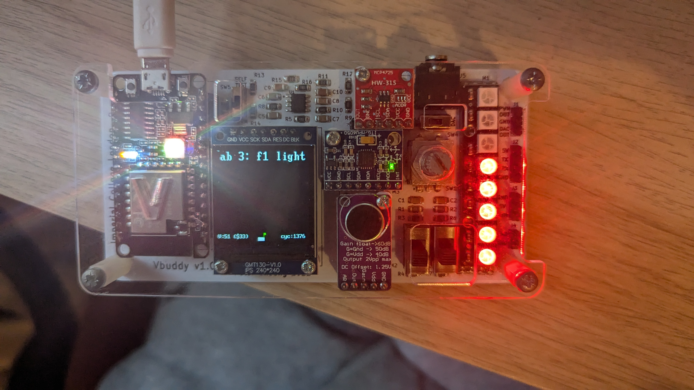

# Task 2: Formula 1 Light Sequence Finite State Machine (FSM)

## Overview

This task implements the Formula 1 (F1) starting light sequence using a synchronous Finite State Machine (FSM) specified in SystemVerilog. In Formula 1 racing, the starting lights consist of a row of red LEDs that turn ON one by one until all lights are illuminated, after which they all turn OFF simultaneously to signal the start of the race.

The FSM is modeled as a 9-state Moore machine (`s0` to `s8`) where outputs depend purely on the current state. The design is verified using both Google Test (`verify.cpp`) for algorithmic validation and an interactive testbench (`f1_fsm_tb.cpp`) driving the Vbuddy platform's rotary switch and 8-LED Neopixel bar.

## Files Included

### 1. F1 Finite State Machine (`f1_fsm.sv`)

```systemverilog
module f1_fsm(
	input logic en, rst, clk, 
	output logic [7:0] data_out
);
	typedef enum {s0, s1, s2, s3, s4, s5, s6, s7, s8} my_state;
	my_state current_state, next_state;
	
	always_ff @(posedge clk, posedge rst) begin
		if (rst) begin
			current_state <= s0;
		end else begin
			current_state <= next_state;
		end
	end
	
	always_comb begin
		case (current_state)
			s0: if (en) next_state = s1;
			s1: if (en) next_state = s2;
			s2: if (en) next_state = s3;
			s3: if (en) next_state = s4;
			s4: if (en) next_state = s5;
			s5: if (en) next_state = s6;
			s6: if (en) next_state = s7;
			s7: if (en) next_state = s8;
			s8: if (en) next_state = s0;
			default: next_state = current_state;
		endcase
	end
	
	always_comb begin
		case (current_state) 
			s0: data_out = 8'b0;
			s1: data_out = 8'b1;
			s2: data_out = 8'b11;
			s3: data_out = 8'b111;
			s4: data_out = 8'b1111;
			s5: data_out = 8'b11111;
			s6: data_out = 8'b111111;
			s7: data_out = 8'b1111111;
			s8: data_out = 8'b11111111;
			default: data_out = 8'b0;
		endcase
	end
	
endmodule
```

### 2. Vbuddy Hardware Testbench (`f1_fsm_tb.cpp`)

```cpp
#include "Vf1_fsm.h"
#include "verilated.h"
#include "verilated_vcd_c.h"
#include "vbuddy.cpp"

int main(int argc, char **argv, char **env) {
	Verilated::commandArgs(argc, argv);
	Vf1_fsm* top = new Vf1_fsm;
	Verilated::traceEverOn(true);
	VerilatedVcdC* tfp = new VerilatedVcdC;
	top->trace(tfp, 99);
	tfp->open("f1_fsm.vcd");

	if (vbdOpen() != 1) return(-1);
	vbdHeader("Lab 3: f1 lights");
	vbdSetMode(0);
		
	top->clk = 0;
	top->rst = 0;
	top->en = 0;
        

	for (int i = 0; i < 1000000; i++) {
		// 1. ALWAYS dump time, toggle the clock, and evaluate the model
		for (int clk = 0; clk < 2; clk++) {
			tfp->dump(2*i + clk);
			top->clk = !top->clk;
			top->eval();
		}
                
        top->en = vbdFlag(); // decides where to reset value to what ever is next line.
		vbdBar(top->data_out & 0xFF);
		vbdCycle(i+1);
		 
		if ((Verilated::gotFinish()) || (vbdGetkey()=='q'))  exit(0);
	}
	vbdClose();
	tfp->close();
	exit(0);
}
```

### 3. Automated Verification Testbench (`verify.cpp`)

```cpp
#include "gtest/gtest.h"
#include "Vdut.h"
#include "verilated.h"
#include "verilated_vcd_c.h"

Vdut *top;
VerilatedVcdC *tfp;
unsigned int ticks = 0;

class TestDut : public ::testing::Test
{
public:
    void SetUp() override
    {
        initializeInputs();
        runReset();
    }

    void TearDown() override
    {
    }

    void initializeInputs()
    {
        top->clk = 0;
        top->rst = 0;
        top->en = 1;
    }

    void runReset()
    {
        top->rst = 1;
        runSimulation();
        top->rst = 0;
    }

    void runSimulation()
    {
        for (int clk = 0; clk < 2; clk++)
        {
            top->eval();
            tfp->dump(2 * ticks + clk);
            top->clk = !top->clk;
        }
        ticks++;

        if (Verilated::gotFinish())
        {
            exit(0);
        }
    }
};

TEST_F(TestDut, InitialStateTest)
{
    top->rst = 1;
    runSimulation();
    EXPECT_EQ(top->data_out, 0x00);
}

TEST_F(TestDut, FSMTest)
{
    top->rst = 1;
    runSimulation();
    EXPECT_EQ(top->data_out, 0b0000);

    top->rst = 0;

    std::vector<int> expected = {
        0b0000'0000,
        0b0000'0001,
        0b0000'0011,
        0b0000'0111,
        0b0000'1111,
        0b0001'1111,
        0b0011'1111,
        0b0111'1111,
        0b1111'1111,
        0b0000'0000};

    for (int exp : expected)
    {
        EXPECT_EQ(top->data_out, exp);
        runSimulation();
    }
}

int main(int argc, char **argv)
{
    top = new Vdut;
    tfp = new VerilatedVcdC;

    Verilated::traceEverOn(true);
    top->trace(tfp, 99);
    tfp->open("waveform.vcd");

    testing::InitGoogleTest(&argc, argv);
    auto res = RUN_ALL_TESTS();

    top->final();
    tfp->close();

    delete top;
    delete tfp;

    return res;
}
```

## FSM Architecture & State Progression

### 3-Process Moore Model

The FSM is structured using industry-standard 3-process architecture:

1. **State Register (`always_ff`)**:
   - Updates `current_state <= next_state` synchronously on `posedge clk`.
   - Supports asynchronous reset `posedge rst` returning the machine immediately to `s0`.

2. **Next-State Logic (`always_comb`)**:
   - Determines transitions from the current state.
   - When enable `en == 1`, advances from $s_k \to s_{k+1}$.
   - From $s_8$, transitions back to $s_0$ (all lights off).
   - If `en == 0`, remains in `current_state`.

3. **Output Logic (`always_comb`)**:
   - As a Moore machine, `data_out` is purely a function of `current_state`.
   - Decodes each state into an 8-bit thermometric pattern turning LEDs on sequentially.

### State Transition & Output Encoding Table

| State | Enable (`en`) | Next State | `data_out[7:0]` (Binary) | Hex | Active LEDs |
| :---: | :---: | :---: | :---: | :---: | :---: |
| `s0` | 1 | `s1` | `8'b00000000` | `0x00` | 0 |
| `s1` | 1 | `s2` | `8'b00000001` | `0x01` | 1 |
| `s2` | 1 | `s3` | `8'b00000011` | `0x03` | 2 |
| `s3` | 1 | `s4` | `8'b00000111` | `0x07` | 3 |
| `s4` | 1 | `s5` | `8'b00001111` | `0x0F` | 4 |
| `s5` | 1 | `s6` | `8'b00011111` | `0x1F` | 5 |
| `s6` | 1 | `s7` | `8'b00111111` | `0x3F` | 6 |
| `s7` | 1 | `s8` | `8'b01111111` | `0x7F` | 7 |
| `s8` | 1 | `s0` | `8'b11111111` | `0xFF` | 8 |

## Vbuddy Hardware Interfacing

### User Input Control

```cpp
top->en = vbdFlag();
```
The rotary encoder switch on Vbuddy acts as the enable input. Pressing the rotary encoder asserts the flag, enabling the FSM to advance to the next state on the following clock cycle.

### Neopixel LED Strip Display

```cpp
vbdBar(top->data_out & 0xFF);
```
`vbdBar()` drives the 8-element Neopixel bar on Vbuddy. Masking with `0xFF` ensures the 8-bit unsigned integer cleanly illuminates LEDs 1 through 8 in sequence as the FSM transitions from `s0` to `s8`.

## Hardware Demonstration

Below is the verified hardware setup running on the Vbuddy board, displaying the sequenced lights on the Neopixel bar:



## Challenge Completed: ✓

The implementation successfully demonstrates:
1. Complete 9-state Moore FSM specified in SystemVerilog using `typedef enum`.
2. Clear 3-process architecture separating synchronous state memory, next-state transitions, and output decoding.
3. Successful automated verification of reset and full cycle light transitions using Google Test (`verify.cpp`).
4. Physical hardware integration with Vbuddy, allowing manual step-through of the F1 start sequence via rotary switch and visual verification on the Neopixel bar.
