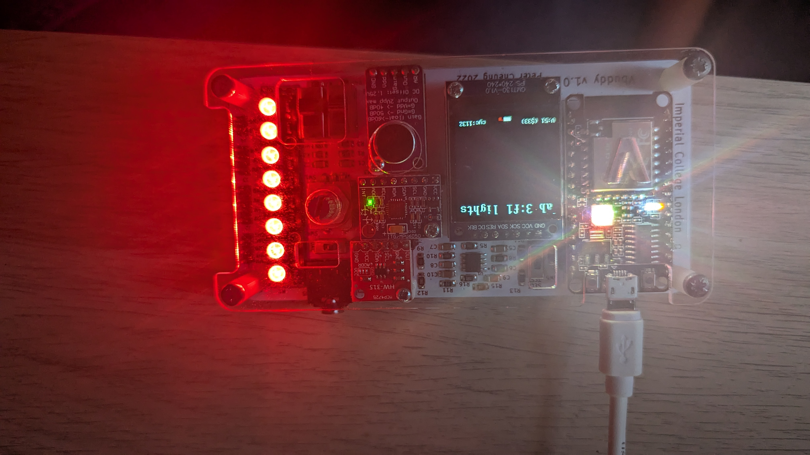

# Task 3: Clock Tick Generator and Automatic F1 Light Sequence

## Overview

This task explores real-time clock division in Verilator simulation and integrates the clock divider with the Formula 1 (F1) state machine from Task 2. 

Because Verilator simulation speed depends on the host machine's processor performance and workload, simulation cycles do not inherently correlate to real-world seconds. The `clktick.sv` module acts as a parameterized clock divider, generating a single-cycle pulse `tick` every $N+1$ clock cycles. By calibrating $N$ against a 60 bpm (1 Hz) audio metronome, we determine the exact division factor required to simulate real-world 1-second intervals. 

Finally, a top-level module `delayed_f1.sv` integrates `clktick.sv` with `f1_fsm.sv` so that the 8-LED F1 light sequence advances automatically at a rate of 1 second per state.

## Files Included

### 1. Top-Level Integration Module (`delayed_f1.sv`)

```systemverilog
module delayed_f1 (
	input logic rst, clk, en,
	output logic [7:0] data_out
);
	logic tick;
	clktick timer (.clk(clk), .rst(rst), .en(en), .N(16'h16), .tick(tick));
	
	f1_fsm lights (.en(tick), .rst(rst), .clk(clk), .data_out(data_out));

endmodule
```

### 2. F1 State Machine (`f1_fsm.sv`)

```systemverilog
module f1_fsm(
	input logic en, rst, clk, 
	output logic [7:0] data_out
);
	typedef enum {s0, s1, s2, s3, s4, s5, s6, s7, s8} my_state;
	my_state current_state, next_state;
	
	always_ff @(posedge clk, posedge rst) begin
		if (rst) begin
			current_state <= s0;
		end else begin
			current_state <= next_state;
		end
	end
	
	always_comb begin
		case (current_state)
			s0: if (en) next_state = s1;
			s1: if (en) next_state = s2;
			s2: if (en) next_state = s3;
			s3: if (en) next_state = s4;
			s4: if (en) next_state = s5;
			s5: if (en) next_state = s6;
			s6: if (en) next_state = s7;
			s7: if (en) next_state = s8;
			s8: if (en) next_state = s0;
			default: next_state = current_state;
		endcase
	end
	
	always_comb begin
		case (current_state) 
			s0: data_out = 8'b0;
			s1: data_out = 8'b1;
			s2: data_out = 8'b11;
			s3: data_out = 8'b111;
			s4: data_out = 8'b1111;
			s5: data_out = 8'b11111;
			s6: data_out = 8'b111111;
			s7: data_out = 8'b1111111;
			s8: data_out = 8'b11111111;
			default: data_out = 8'b0;
		endcase
	end
	
endmodule
```

### 3. Clock Tick Generator (`clktick.sv`)

```systemverilog
module clktick #(
    parameter WIDTH = 16
)(
  // interface signals
  input  logic             clk,      // clock 
  input  logic             rst,      // reset
  input  logic             en,       // enable signal
  input  logic [WIDTH-1:0] N,     	 // clock divided by N+1
  output logic  		   tick      // tick output
);

logic [WIDTH-1:0] count;

always_ff @ (posedge clk)
    if (rst) begin
        tick <= 1'b0;
        count <= N;  
        end
    else if (en) begin
        if (count == 0) begin
            tick <= 1'b1;
            count <= N;
            end
        else begin
            tick <= 1'b0;
            count <= count - 1'b1;
            end
        end
endmodule
```

### 4. Interactive Testbench (`f1_fsm_tb.cpp`)

```cpp
#include "Vdelayed_f1.h"
#include "verilated.h"
#include "verilated_vcd_c.h"
#include "vbuddy.cpp"

int main(int argc, char **argv, char **env) {
	Verilated::commandArgs(argc, argv);
	Vdelayed_f1* top = new Vdelayed_f1;
	Verilated::traceEverOn(true);
	VerilatedVcdC* tfp = new VerilatedVcdC;
	top->trace(tfp, 99);
	tfp->open("delayed_f1.vcd");

	if (vbdOpen() != 1) return(-1);
	vbdHeader("Lab 3:f1 lights");
	vbdSetMode(0);
		
	top->clk = 0;
	top->rst = 0;
    top->en = 0;

	for (int i = 0; i < 1000000; i++) {
		// 1. ALWAYS dump time, toggle the clock, and evaluate the model
		for (int clk = 0; clk < 2; clk++) {
			tfp->dump(2*i + clk);
			top->clk = !top->clk;
			top->eval();
		}
              
        top->en = vbdFlag();
		vbdBar(top->data_out & 0xFF);
		vbdCycle(i+1);
		 
		if ((Verilated::gotFinish()) || (vbdGetkey()=='q'))  exit(0);
	}
	vbdClose();
	tfp->close();
	exit(0);
}
```

## Clock Divider & Calibration Mechanism

### How `clktick.sv` Operates

The `clktick` module contains an internal down-counter (`count`) initialized to `N`:
1. When `en` is active, the counter decrements by `1` on each rising clock edge.
2. When the counter reaches zero (`count == 0`), `tick` is pulsed high (`1'b1`) for exactly one clock cycle, and `count` is reloaded back to `N`.
3. In all other cycles, `tick` remains `1'b0`.
4. The output frequency is therefore:
   $$f_{\text{tick}} = \frac{f_{\text{clk}}}{N + 1}$$

### Real-Time Simulation Calibration (60 BPM)

Since Verilator runs on software time, the effective $f_{\text{clk}}$ is dictated by CPU speed and simulation loop overhead. To calibrate this for a 1-second period:

1. The testbench was initially run using `clktick_tb.cpp` while listening to a Google metronome set to **60 BPM** (1 beat per second).
2. The rotary encoder was adjusted to tune the flashing rate of the Vbuddy Neopixel bar until the flashes synchronized perfectly with the metronome beat.
3. The calibrated parameter value obtained for a 1-second tick period was **`0x16`** (decimal 22).
4. This calibrated value `16'h16` was then hardcoded as the constant `N` parameter input in `delayed_f1.sv`.

## Top-Level System Integration (`delayed_f1.sv`)

In `delayed_f1.sv`, the two components are seamlessly connected:
- The top-level input `en` drives the clock divider's enable line.
- The `clktick` pulse output (`tick`) directly connects to the `en` input of `f1_fsm`.
- Every 1 second (every $22 + 1 = 23$ clock cycles), `tick` asserts for one cycle, commanding the FSM to transition from $s_k \to s_{k+1}$.
- As a result, the 8 Neopixel LEDs turn ON sequentially, one light every second, until all 8 are illuminated, after which they turn OFF and repeat.

## Hardware Demonstration

Below is the verified hardware setup running on the Vbuddy board, cycling through the automated 1-second light sequence:



## Challenge Completed: ✓

The implementation successfully demonstrates:
1. Understanding of software simulation timing constraints vs. real-world time.
2. Calibration of `clktick.sv` to a 60 BPM metronome, determining the calibrated divider value **`0x16`**.
3. Modular top-level design in SystemVerilog interconnecting `clktick` and `f1_fsm`.
4. Fully automated cycling of the 8-stage F1 starting lights at 1-second intervals on Vbuddy.
